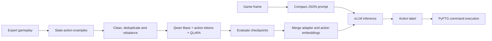

# MambaGPT — DareFightingICE

**Third place in the 2026 DareFightingICE LLM AI Competition — Team MambaGPT.** [Official competition results](https://www.ice.ci.ritsumei.ac.jp/~ftgaic/index-R.html).

MambaGPT fine-tunes **Qwen2.5-1.5B Base** to choose fighting-game actions from structured game observations. It learns from expert demonstrations, with **BlackMamba for Rushdown** and **Modified MctsAiZoning for Zoning**, and runs through the FightingLLM/PyFTG controller.

This repository covers the AI workflow: expert data, preprocessing, action-token preparation, QLoRA fine-tuning, checkpoint evaluation, model export, inference changes, and experiments from v3 through v8.

## Models

| Policy | Model weights and tokenizer | Configuration |
|---|---|---|
| Rushdown v3 | [ThrowbacKid/rushdown-merged-v3](https://huggingface.co/ThrowbacKid/rushdown-merged-v3) | [Model config](configs/rushdown-v3/config.json) · [Tokenizer config](configs/rushdown-v3/tokenizer_config.json) |
| Zoning v3 | [ThrowbacKid/zoning-merged-v3](https://huggingface.co/ThrowbacKid/zoning-merged-v3) | [Model config](configs/zoning-v3/config.json) · [Tokenizer config](configs/zoning-v3/tokenizer_config.json) |

The model weights and full `tokenizer.json` are hosted on Hugging Face. The small configuration snapshots are included here. Both model repositories use Hugging Face's access gate; sign in and request access to download the model files.

## Workflow

Each observation describes both fighters' HP, energy, action, state, remaining action frames, position, velocity, and projectiles. Training maps this JSON to one action token. Prompt tokens are masked in the loss, and the target is the action followed by EOS.

The training recipe uses four-bit NF4 loading, LoRA, trainable embedding/output modules, batch size **16**, and **three epochs**, with a checkpoint after each completed epoch. Training runs through all epochs by default. [Methodology](docs/methodology.md) explains the configuration and action representation.

## Datasets and source

Small samples from **all 50 raw, intermediate, and versioned dataset files** are included under [datasets/samples](datasets/samples/), together with a [dataset guide](datasets/README.md) and [sampling manifest](datasets/manifest.json). The samples contain 46,438 original lines and total about 31 MiB. They support code exploration and workflow examples; the benchmark results below used the full datasets.

| Location | Contents |
|---|---|
| [Preprocessing](src/preprocessing/) | Validation, JSON repair, deduplication, rebalancing and versioned data preparation |
| [Training](src/training/) | Action-token base preparation, QLoRA training and merged-model export |
| [Evaluation](src/evaluation/) | Action prediction, gameplay CSV summaries, class distributions and DAgger analysis |
| [Inference patch](patches/submitted-runtime.patch) | MambaGPT's changes to the FightingLLM runtime |
| [Experiment history](docs/experiments.md) | Version differences, results and lessons |
| [Reproduction guide](docs/reproduction.md) | Commands for processing, training, evaluation and export |
| [Inference guide](docs/inference.md) | Runtime changes and game integration |

## Results

### Local development evaluations

| Rushdown version | Main change | Baseline win rate |
|---|---|---:|
| **v3** | Cleaned and rebalanced expert data without position jitter | **98%** |
| v4 | Recollected dataset | 18% |
| v5 | Less aggressive filtering and capped continuation examples | 83% |
| v6 | Targeted repeated-fireball filtering | 51% |
| v7 | Continued training from v3 on v6 data | 94% |
| v8 | Disagreement-focused DAgger data mixed with v3 examples | 20% |

The v3 checkpoint comparison evaluated 100 games per checkpoint: epochs 1, 2, and 3 achieved 98%, 49%, and 94% against the baseline. These development evaluations are separate from the competition standings. [Full experiment history](docs/experiments.md).

### Competition

Team MambaGPT placed **third overall**. The organizer's Standard-league match records give:

| Style | Games | Rounds | Wins | Losses | Draws |
|---|---:|---:|---:|---:|---:|
| Rushdown | 18 | 54 | 42 | 12 | 0 |
| Zoning | 18 | 54 | 26 | 23 | 5 |

[Opponent-level summary](results/official_standard_summary.csv) · [Result calculation](docs/provenance.md).

## Lessons

- **Gameplay evaluation matters.** Increasing offline action accuracy did not consistently improve match performance.
- **Repeated actions need context.** Removing loops can also discard useful action continuation.
- **Training and inference must agree.** Tokenization, JSON keys, prompts, and exported embeddings/output heads all affect action prediction.
- **More corrective data is not automatically better.** The DAgger experiment motivated broader expert-state coverage and preserving the earlier policy.

## Getting started

Start with the [reproduction guide](docs/reproduction.md). Dataset inspection and preprocessing examples use Python's standard library; fine-tuning requires a compatible CUDA environment and the packages in `requirements.txt`. The included samples demonstrate the workflow rather than reproduce the full-data benchmark scores.

**Stack:** Python, PyTorch, Transformers, PEFT/LoRA, bitsandbytes, vLLM, PyFTG, and FightingICE.

Acknowledgments: the [FightingICE/FightingLLM developers](https://github.com/TeamFightingICE), BlackMamba's developers, and the Qwen team. [References and model resources](docs/provenance.md).
